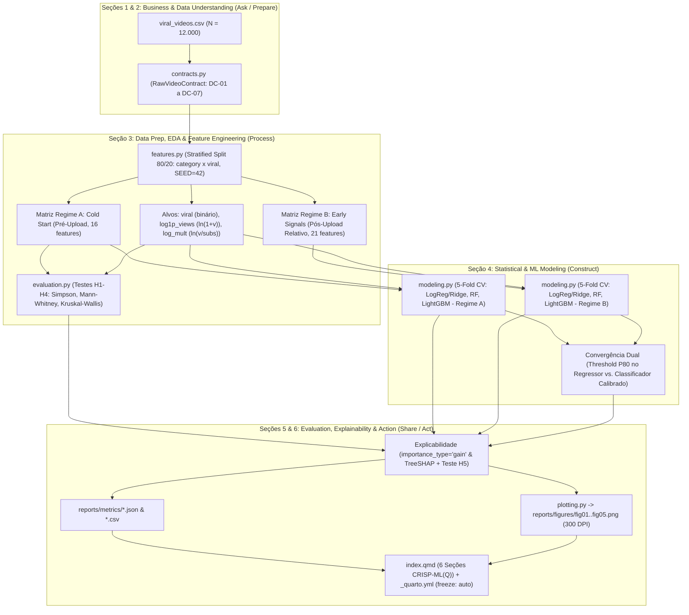

# Gate 3: Arquitetura do Pipeline: Data Prep, Modeling, Evaluation & Storytelling (*Process, Construct & Share*)

- **Projeto:** `youtube_viral_video_prediction`
- **Arquétipo:** A — Data Science, Analytics & Machine Learning (`python-uv-quarto`)
- **Metodologia:** Modelo Híbrido CRISP-ML(Q) + Data Storytelling em 6 Seções
- **Etapa Atual:** Gate 3 — *Data Prep, Modeling, Evaluation & Storytelling (Process, Construct & Share)*
- **Data:** 2026-10-15

---

## 1. Topologia do Pipeline Analítico (CRISP-ML(Q) + Storytelling)

A arquitetura separa fisicamente a execução computacional em `src/youtube_viral/` da camada de publicação em `index.qmd`. Os módulos validam contratos em tempo de execução, geram os conjuntos de atributos isolados por regime temporal, treinam os estimadores em validação cruzada estratificada e exportam métricas auditadas (`reports/metrics/`) e figuras em 300 DPI (`reports/figures/`) antes da compilação do Quarto.

---

## 2. Arquitetura de *Data Prep, EDA & Feature Engineering* (*Process* — Seções 2 e 3)

### 2.1. Validação Contratual e Barreira Anti-Leakage (`src/youtube_viral/contracts.py`)

O módulo `contracts.py` implementa duas funções de guarda obrigatórias:
1. `validate_raw_dataset(df: pd.DataFrame) -> pd.DataFrame`: Verifica as regras `DC-01` a `DC-06` (dimensões $12.000 \times 15$, zero nulos, unicidade de `video_id`, domínios de `category` e `upload_day`, positividade de `views` e `subscriber_count`, e fronteira determinística $P_{80}$ em $734.379$ views).
2. `assert_no_leakage(feature_names: Sequence[str], regime: Literal["A", "B"]) -> None`: Dispara `ValueError` caso qualquer coluna de vazamento (`views`, `viral`, `likes`, `comments`, `shares`, `log_views`, `views_per_sub`, `log_views_per_sub`) esteja presente em $X$, ou caso sinais relativos pós-upload estejam presentes quando `regime == "A"`.

### 2.2. Transformações Matemáticas e Isolamento de Regimes (`src/youtube_viral/features.py`)

| Regime | Atributo Gerado | Transformação Matemática | Papel Analítico |
| :--- | :--- | :--- | :--- |
| **Regime A (Cold Start)** | `log_subscriber_count` | $\ln(1 + \text{subscriber\_count})$ | Corrige a *skewness* de $+14,47$ para $+0,15$ e captura a elasticidade de canal. |
| **Regime A (Cold Start)** | `log_duration_sec` | $\ln(1 + \text{duration\_sec})$ | Suaviza a cauda direita de vídeos longos ($30\text{s}$ a $1.960\text{s}$). |
| **Regime A (Cold Start)** | `tags_per_title_char` | $\frac{\text{tags\_count}}{\max(1, \text{title\_length})}$ | Densidade de indexação por caractere de título. |
| **Regime A (Cold Start)** | `desc_to_title_ratio` | $\frac{\text{description\_length}}{\max(1, \text{title\_length})}$ | Razão de expansão semântica entre descrição e título. |
| **Regime A (Cold Start)** | `has_description`, `has_tags` | $\mathbb{I}(\text{description\_length} > 0)$, $\mathbb{I}(\text{tags\_count} > 0)$ | Indicadores binários de preenchimento de metadados. |
| **Regime A (Cold Start)** | `hour_sin`, `hour_cos` | $\sin\left(\frac{2\pi \cdot \text{upload\_hour}}{24}\right)$, $\cos\left(\frac{2\pi \cdot \text{upload\_hour}}{24}\right)$ | Coordenadas harmônicas para continuidade de meia-noite ($23\text{h} \to 00\text{h}$). |
| **Regime A (Cold Start)** | `is_weekend` | $\mathbb{I}(\text{upload\_day} \in \{\text{Sat, Sun}\})$ | Indicador binário de publicação em fim de semana. |
| **Regime A (Cold Start)** | `category`, `upload_day` | `OneHotEncoder(handle_unknown='ignore')` em `ColumnTransformer` | Preserva os efeitos fixos das $15$ categorias e $7$ dias sem vazamento entre folds. |
| **Regime B (Early Signals)** | `like_rate`, `comment_rate`, `share_rate` | $\frac{\text{likes}}{\text{views}}$, $\frac{\text{comments}}{\text{views}}$, $\frac{\text{shares}}{\text{views}}$ | Taxas adimensionais de receptividade livres da escala bruta de `views`. |
| **Regime B (Early Signals)** | `engagement_rate_total` | $\frac{\text{likes} + \text{comments} + \text{shares}}{\text{views}}$ | Taxa agregada de interação por visualização. |
| **Regime B (Early Signals)** | `comments_per_like`, `shares_per_like` | $\frac{\text{comments}}{\max(1, \text{likes})}$, $\frac{\text{shares}}{\max(1, \text{likes})}$ | Proporções internas entre engajamentos profundos e curtidas. |

---

## 3. Arquitetura de *Statistical & ML Modeling* (*Construct* — Seção 4)

O módulo `src/youtube_viral/modeling.py` estrutura três frentes supervisionadas avaliadas sobre as mesmas $5$ dobras estratificadas (`StratifiedKFold(n_splits=5, shuffle=True, random_state=42)` sobre o estrato composto `category_viral`) e validadas no cofre de teste ($N = 2.400$):

1. **Frente 1 — Regressão Contínua de Alcance ($y_i = \ln(1 + \text{views}_i)$):**
   - *Baseline:* preditor de média estratificada por categoria (`DummyRegressor` / `CategoryMeanBaseline`).
   - *Modelo Linear Regularizado:* `Ridge(alpha=1.0, random_state=42)`.
   - *Bagging Não-Linear:* `RandomForestRegressor(n_estimators=300, max_depth=12, min_samples_leaf=5, random_state=42, n_jobs=-1)`.
   - *Gradient Boosting:* `LGBMRegressor(n_estimators=300, learning_rate=0.05, num_leaves=31, subsample_for_bin=10000, random_state=42, n_jobs=-1, verbose=-1)`.
2. **Frente 2 — Classificação Binária Calibrada ($z_i = \text{viral}_i \in \{0, 1\}$):**
   - *Baseline:* prevalência estratificada por categoria.
   - *Modelo Linear:* `LogisticRegression(C=1.0, max_iter=1000, random_state=42)`.
   - *Bagging Não-Linear:* `RandomForestClassifier(n_estimators=300, max_depth=12, min_samples_leaf=5, random_state=42, n_jobs=-1)`.
   - *Gradient Boosting:* `LGBMClassifier(n_estimators=300, learning_rate=0.05, num_leaves=31, random_state=42, n_jobs=-1, verbose=-1)`.
   - *Convergência Dual (Regressor Thresholded at $P_{80}$):* Uso das predições contínuas $\hat{y}_i$ do `LGBMRegressor` como escore de ordenação para cálculo de `PR-AUC`, `ROC-AUC` e decisão binária $\hat{z}_i = \mathbb{I}(\hat{y}_i \ge Q_{0,80}(\hat{y}))$.
3. **Frente 3 — Modelo de Desconfundimento do Multiplicador ($M_i = \ln(\text{views}_i / \text{subscriber\_count}_i)$):**
   - Treinamento de `Ridge` e `LGBMRegressor` **excluindo `subscriber_count` e `log_subscriber_count` da matriz $X$**, isolando o ganho puro das escolhas do criador (`thumbnail_face`, `tags_count`, `duration_sec`, `title_length`, `description_length`, `upload_hour`, `upload_day`, `category`).

---

## 4. Arquitetura de *Evaluation, Diagnostics & Explainability* (*Share* — Seção 5)

Em conformidade estrita com `/home/tales/.gemini/config/skills/pre-code-pipeline/references/quarto-quality-checklist.md`:

- **Explicabilidade Unificada (`gain` & TreeSHAP):** A extração de importância de variáveis no LightGBM utilizará `importance_type="gain"` (redução percentual real da função de perda) e contribuições marginais SHAP (`pred_contrib=True` nativo do LightGBM TreeSHAP), garantindo que a ordem narrada na prosa da Seção 5 seja 100% idêntica às barras renderizadas na Figura 5.
- **Padronização Gráfica das 5 Figuras (`src/youtube_viral/plotting.py`):**
  - Todos os gráficos são painéis duplos `(1, 2)` com `figsize=(12, 5.2)`, `constrained_layout=True`, `ax.set_box_aspect(1)` em ambos os subgráficos, `sns.despine()` e `dpi=300`.

| Figura / Arquivo (`reports/figures/`) | Seção Quarto (CRISP-ML(Q)) | Subfigura `(a)` — `axes[0].set_box_aspect(1)` | Subfigura `(b)` — `axes[1].set_box_aspect(1)` |
| :--- | :--- | :--- | :--- |
| **`fig01_distributions_and_threshold.png`** | **Seção 3** (*Data Prep & EDA / Process*) | Distribuição de $\log_{10}(\text{views})$ com separação exata no corte $P_{80}$ ($734.379$ views, $20,0\%$ viral). | Dispersão densa $\log_{10}(\text{subscriber\_count})$ vs. $\log_{10}(\text{views})$ com reta de elasticidade ($r = +0,81$). |
| **`fig02_simpson_paradox_categories.png`** | **Seção 3** (*Data Prep & EDA / Process*) | Perfil das 15 categorias ordenado por taxa de viralidade (%) vs. mediana de inscritos ($\log_{10}$). | Decomposição do Paradoxo de Simpson: efeito de `duration_sec` sobre $\ln(\text{views})$ bruto ($r=-0,20$) vs. sobre $\ln(\text{views}/\text{subs})$ ($r=-0,01$). |
| **`fig03_creator_levers_and_timing.png`** | **Seção 3** (*Data Prep & EDA / Process*) | Efeito líquido das alavancas pré-upload (`thumbnail_face` e `tags_count`) sobre o multiplicador $\ln(\text{views}/\text{subs})$ por faixa de canal. | Perfil temporal (`upload_hour` $0\text{--}23$ $\times$ Dia Útil / Fim de Semana) evidenciando neutralidade estatística ($H_4$). |
| **`fig04_dual_modeling_performance.png`** | **Seção 4** (*Modeling*) / **Seção 5** (*Evaluation*) | Curvas Precision-Recall (`PR-AUC`) no conjunto de teste ($N=2.400$) comparando classificadores e o regressor dual limiarizado em $P_{80}$. | Diagnóstico de regressão: $\log_{10}(\text{views})$ predito vs. observado no teste com fronteiras de decisão em $P_{80}$ ($R^2$ e `RMSLE`). |
| **`fig05_scenario_a_vs_b_importance.png`** | **Seção 5** (*Evaluation, Diagnostics & Explainability / Share*) | Comparação multi-métrica (`PR-AUC` e `RMSLE` com IC 95%) entre **Regime A (*Cold Start*)** e **Regime B (*Early Signals*)** ($H_5$). | Importância de atributos por ganho (`importance_type='gain'`) e impacto SHAP confirmando a hierarquia de preditores. |

---

## 5. Estrutura Canônica de 6 Seções no Relatório Quarto (`index.qmd`)

O documento `index.qmd` seguirá exatamente os cabeçalhos de nível 2 abaixo (sem numeração manual, pois `number-sections: true` está ativo no `_quarto.yml`):

1. `## Contexto de Negócio e Hipóteses` (*Business Understanding / Ask*)
2. `## Auditoria de Dados e Contratos de Qualidade` (*Data Understanding / Prepare*)
3. `## Análise Exploratória e Engenharia de Atributos` (*Data Prep & EDA / Process*)
4. `## Modelagem Estatística e Machine Learning` (*Modeling / Construct*)
5. `## Avaliação, Diagnóstico e Explicabilidade` (*Evaluation / Share*)
6. `## Recomendações Executivas e Plano de Ação` (*Deployment / Act*)

---

## 6. Registros de Decisão Arquitetural (`docs/adr/`)

- [`docs/adr/0001-dual-target-and-anti-leakage-architecture.md`](file:///home/tales/Documentos/github/youtube_viral_video_prediction/docs/adr/0001-dual-target-and-anti-leakage-architecture.md) — Arquitetura de modelagem dual + multiplicador de desconfundimento e isolamento anti-leakage entre Regimes A e B.
- [`docs/adr/0002-stack-uv-sklearn-lightgbm-quarto.md`](file:///home/tales/Documentos/github/youtube_viral_video_prediction/docs/adr/0002-stack-uv-sklearn-lightgbm-quarto.md) — Stack científica (`uv`, `scikit-learn`, `lightgbm` com TreeSHAP/`gain`) e renderização *Artifact-First* nas 6 seções do CRISP-ML(Q) + Storytelling.
