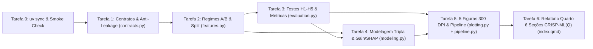

# Gate 5: Plano de Implementação, Validação & Action (*Deployment / Act*)

- **Projeto:** `youtube_viral_video_prediction`
- **Arquétipo:** A — Data Science, Analytics & Machine Learning (`python-uv-quarto`)
- **Metodologia:** Modelo Híbrido CRISP-ML(Q) + Data Storytelling em 6 Seções
- **Etapa Atual:** Gate 5 — *Plano de Implementação, Validação & Action (Deployment / Act)*
- **Data:** 2026-10-15

---

## 1. Grafo de Precedência Técnica e Ciclos TDD

A fase de execução (`execution-pipeline`) seguirá estritamente a ordem de dependências abaixo. Cada módulo em `src/youtube_viral/` é precedido pela escrita de seus testes em `tests/` (**Fase RED**), seguida da implementação mínima para aprovação (**Fase GREEN**) e saneamento de código via `ruff` (**Fase REFACTOR**).



---

## 2. Checklist Atômico de Implementação (Passo a Passo)

### Tarefa 0: Provisionamento do Ambiente Isolado (`uv`)

- **Arquivos:** `pyproject.toml`, `uv.lock`
- **Comandos de Verificação:**
  ```bash
  /home/tales/.local/bin/uv sync
  /home/tales/.local/bin/uv run pytest --version
  /home/tales/.local/bin/uv run ruff --version
  /opt/quarto/bin/quarto --version
  ```

---

### Tarefa 1: Contratos de Dados e Barreira Anti-Leakage (`DC-01` a `DC-07`)

- **Arquivos Alvo:**
  - Criar: `tests/conftest.py` e `tests/test_contracts.py` (**RED**)
  - Criar: `src/youtube_viral/contracts.py` (**GREEN**)
- **Escopo de Testes (`tests/test_contracts.py`):**
  1. `test_validate_raw_dataset_passes_on_real_csv()`: Valida as $12.000$ linhas, zero nulos, $15$ categorias e corte exato no percentil $80$ ($734.299 < 734.379$).
  2. `test_validate_raw_dataset_rejects_corrupted_rows()`: Verifica disparo de `ValueError` para nulos, IDs duplicados ou violação da fronteira de `viral`.
  3. `test_assert_no_leakage_blocks_target_and_proxy_leakage()`: Garante que `views`, `viral`, `likes`, `comments` e `shares` absolutos sejam rejeitados em qualquer regime (`DC-07`).
  4. `test_assert_no_leakage_isolates_regime_a_from_regime_b()`: Garante que `like_rate`, `comment_rate` e `share_rate` falhem quando `regime="A"` e passem quando `regime="B"`.
- **Verificação Automatizada:**
  ```bash
  /home/tales/.local/bin/uv run pytest tests/test_contracts.py
  /home/tales/.local/bin/uv run ruff check src/youtube_viral/contracts.py tests/test_contracts.py
  ```

---

### Tarefa 2: Particionamento Estratificado e Matrizes dos Regimes A e B (*Data Prep & Feature Engineering*)

- **Arquivos Alvo:**
  - Criar: `tests/test_features.py` (**RED**)
  - Criar: `src/youtube_viral/features.py` (**GREEN**)
- **Escopo de Testes (`tests/test_features.py`):**
  1. `test_stratified_split_80_20_preserves_joint_distribution()`: Verifica partição determinística ($9.600$ treino / $2.400$ teste, `SEED = 42`), disjunção de `video_id` e manutenção dos $20,0\%$ de vídeos virais.
  2. `test_build_regime_a_features()`: Confirma geração de `log_subscriber_count`, `log_duration_sec`, `tags_per_title_char`, `desc_to_title_ratio`, `hour_sin`, `hour_cos`, `is_weekend` e aprovação em `assert_no_leakage(..., regime="A")`.
  3. `test_build_regime_b_features()`: Confirma adição de `like_rate`, `comment_rate`, `share_rate`, `engagement_rate_total`, `comments_per_like`, `shares_per_like` sem `NaN`/`inf` e aprovação em `assert_no_leakage(..., regime="B")`.
  4. `test_build_targets_triple_architecture()`: Verifica cálculo exato de `viral` ($\{0, 1\}$), `log1p_views` ($\ln(1 + \text{views})$) e `log_views_per_sub` ($\ln(\text{views}/\text{subscriber\_count})$).
- **Verificação Automatizada:**
  ```bash
  /home/tales/.local/bin/uv run pytest tests/test_features.py
  /home/tales/.local/bin/uv run ruff check src/youtube_viral/features.py tests/test_features.py
  ```

---

### Tarefa 3: Testes de Hipóteses Estatísticas ($H_1$ a $H_5$) e Funções de Avaliação

- **Arquivos Alvo:**
  - Criar: `tests/test_evaluation.py` (**RED**)
  - Criar: `src/youtube_viral/evaluation.py` (**GREEN**)
- **Escopo de Testes (`tests/test_evaluation.py`):**
  1. `test_regression_and_classification_metrics()`: Verifica cálculo de `RMSLE`, `MAE_ln`, `R2_ln`, `MdAPE` (com fator *smearing* de Duan), `PR-AUC`, `ROC-AUC`, `F1@0.50`, `F1@P80` e `Brier`.
  2. `test_simpson_paradox_deconfounding_h2()`: Confirma matematicamente que $r(\text{duration\_sec}, \ln(1+\text{views})) < -0,18$ ($p < 10^{-4}$), enquanto $r(\text{duration\_sec}, \ln(\text{views}/\text{subs})) \in [-0,02;\, +0,02]$ ($p > 0,05$).
  3. `test_creator_levers_h3_and_timing_neutrality_h4()`: Confirma efeito positivo significativo de `thumbnail_face` e `tags_count` ($p < 0,001$) e ausência de efeito horário/diário ($p > 0,05$).
- **Verificação Automatizada:**
  ```bash
  /home/tales/.local/bin/uv run pytest tests/test_evaluation.py
  /home/tales/.local/bin/uv run ruff check src/youtube_viral/evaluation.py tests/test_evaluation.py
  ```

---

### Tarefa 4: Modelagem Supervisionada Tripla, Convergência Dual $P_{80}$ e Explicabilidade (`gain` + TreeSHAP)

- **Arquivos Alvo:**
  - Criar: `tests/test_modeling.py` (**RED**)
  - Criar: `src/youtube_viral/modeling.py` (**GREEN**)
- **Escopo de Testes (`tests/test_modeling.py`):**
  1. `test_supervised_models_outperform_baselines()`: Verifica que `LogisticRegression`/`Ridge`, `RandomForest` e `LightGBM` superam o baseline estratificado em 5-Fold CV e no teste.
  2. `test_dual_convergence_regressor_p80()`: Verifica que a decisão binária induzida pelo `LGBMRegressor` no corte $P_{80}$ atinge `PR-AUC` e `F1@P80` consistentes com o `LGBMClassifier`.
  3. `test_regime_a_vs_regime_b_h5_and_explainability()`: Confirma a Hipótese $H_5$ ($|\Delta \text{PR-AUC}| < 0,015$ e $|\Delta \text{RMSLE}| < 0,015$) e valida a extração de `importance_type="gain"` e contribuições `TreeSHAP` (`pred_contrib=True`).
- **Verificação Automatizada:**
  ```bash
  /home/tales/.local/bin/uv run pytest tests/test_modeling.py
  /home/tales/.local/bin/uv run ruff check src/youtube_viral/modeling.py tests/test_modeling.py
  ```

---

### Tarefa 5: Geração das 5 Figuras de Publicação (300 DPI) e Orquestrador (`reports/`)

- **Arquivos Alvo:**
  - Criar: `src/youtube_viral/plotting.py`, `src/youtube_viral/pipeline.py` e `tests/test_pipeline_outputs.py`.
- **Escopo de Testes (`tests/test_pipeline_outputs.py`):**
  1. `test_pipeline_exports_all_metrics_and_300dpi_figures()`: Confirma que `reports/metrics/summary_results.json`, `reports/metrics/model_comparison.csv` e os 5 arquivos `reports/figures/fig01..fig05.png` existem, possuem resolução de 300 DPI e seguem o layout `1x2` nivelado.
- **Verificação Automatizada:**
  ```bash
  /home/tales/.local/bin/uv run python -m youtube_viral.pipeline
  /home/tales/.local/bin/uv run pytest
  /home/tales/.local/bin/uv run ruff check .
  ```

---

### Tarefa 6: Redação do Relatório Quarto nas 6 Seções Canônicas (`index.qmd`), `README.md` e Render HTML

- **Arquivos Alvo:**
  - Modificar: `index.qmd` (preenchimento completo nas 6 seções do **CRISP-ML(Q) + Data Storytelling**, citando os números exatos de `reports/metrics/summary_results.json` e exibindo `fig01..fig05.png`).
  - Modificar: `README.md` (documentação executiva do projeto, arquitetura e reprodutibilidade).
- **Verificação Automatizada Final:**
  ```bash
  /opt/quarto/bin/quarto render index.qmd
  /home/tales/.local/bin/uv run pytest
  /home/tales/.local/bin/uv run ruff check . && /home/tales/.local/bin/uv run ruff format --check .
  ```
