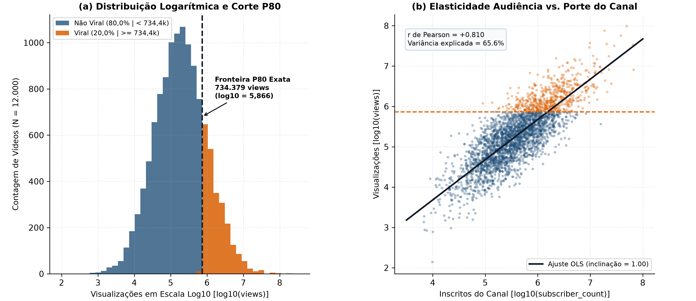
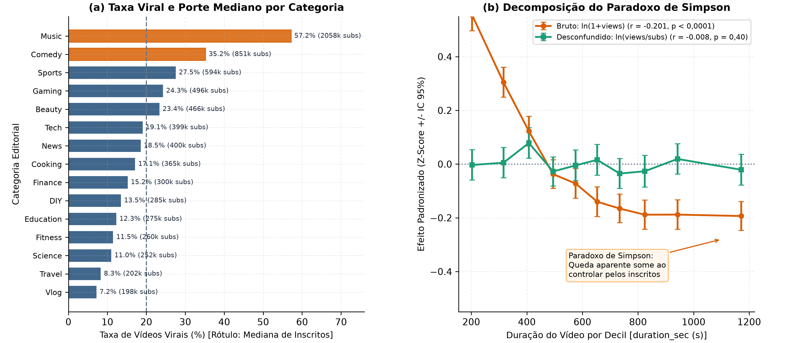
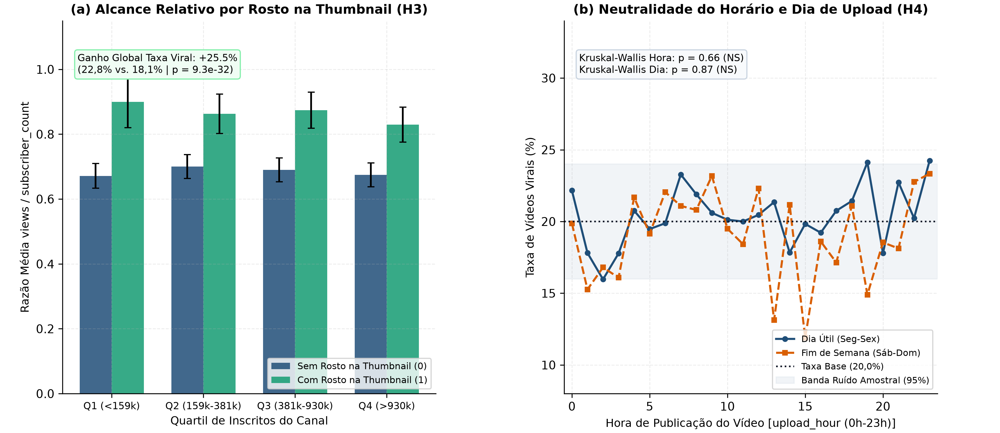
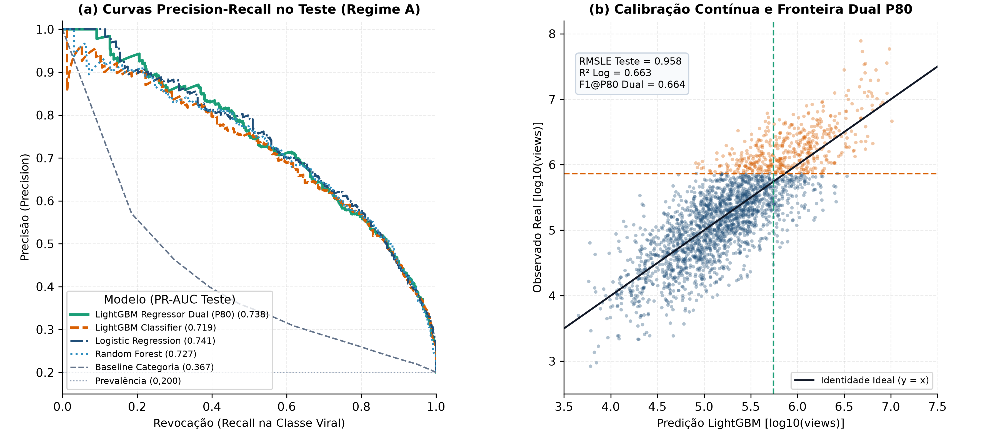
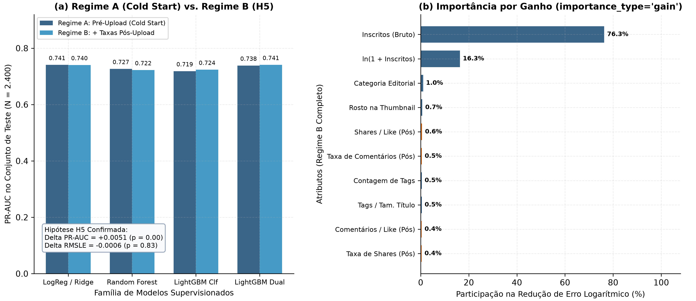

## Contexto de Negócio e Hipóteses

A alocação de orçamento editorial e o desenho de sistemas de recomendação em plataformas de vídeo dependem de separar o efeito inercial da audiência acumulada pelo canal das alavancas reais de conteúdo controladas pelo criador. Na base auditada de $12.000$ vídeos distribuídos em $15$ categorias editoriais (`viral_videos.csv`), o indicador binário de viralidade (`viral = 1`) é definido deterministicamente pelo corte do percentil $80$ ($P_{80}$) do volume de visualizações (`views`), cuja fronteira exata ocorre entre $734.299$ e $734.379$ visualizações ($2.400$ vídeos virais, taxa base de $20,00\%$).

::: {.callout-important}
### Síntese Executiva dos Resultados
1. **Dominância Estrutural da Base de Inscritos ($H_1$ Confirmada):** A contagem de inscritos em escala logarítmica ($\ln(1 + \text{subscriber\_count})$) apresenta correlação de $r = 0,8097$ ($p < 10^{-300}$) com $\ln(1 + \text{views})$ e explica isoladamente $65,56\%$ da variância total ($R^2 = 0,6556$). No modelo `LightGBM` de pré-publicação, o porte do canal concentra $93,59\%$ do ganho total de informação na regressão e $80,09\%$ na classificação.
2. **Paradoxo de Simpson na Duração do Vídeo ($H_2$ Confirmada):** A correlação marginal negativa entre `duration_sec` e $\ln(1 + \text{views})$ ($r = -0,2015, p = 3,97 \times 10^{-110}$) é um artefato de confundimento por categoria. Categorias de vídeos curtos (`Music` com mediana de $239\text{s}$ e $57,2\%$ de viralidade; `Comedy` com $297\text{s}$ e $35,2\%$) abrigam canais $5\text{x}$ a $10\text{x}$ maiores que categorias longas (`Travel`, `Vlog`). Ao normalizar pelo porte do canal ($\ln(\text{views}/\text{subscriber\_count})$), o efeito da duração desaparece ($r = -0,0077, p = 0,3966$).
3. **Alavancas Acionáveis pelo Criador ($H_3$ Confirmada):** Incluir um rosto humano na miniatura (`thumbnail_face = 1`) eleva a taxa de viralização de $18,15\%$ para $22,78\%$, um ganho relativo de $+25,52\%$ ($p = 9,34 \times 10^{-32}$), aumentando a razão de visualizações por inscrito em $+24,39\%$. A densidade de indexação via `tags_count` preserva correlação positiva após o desconfundimento ($r = +0,0549, p = 1,83 \times 10^{-9}$).
4. **Neutralidade de Data e Hora de Upload ($H_4$ Confirmada):** O horário de publicação (`upload_hour`, Kruskal-Wallis $p = 0,6606$) e o dia da semana (`upload_day`, Kruskal-Wallis $p = 0,8717$) não exercem efeito estatisticamente significativo sobre o alcance relativo.
5. **Suficiência do Regime de Pré-Publicação ($H_5$ Confirmada):** A adição de seis taxas relativas de engajamento pós-upload (Regime B) altera o `PR-AUC` de teste em apenas $+0,0051$ no `LightGBM` ($0,7185 \to 0,7237$) e mantém a regressão inalterada (`RMSLE` de $0,9584$ vs. $0,9578$, $p = 0,8331$). O modelo linear regularizado (`LogisticRegression` / `Ridge`) e a **Convergência Dual** do `LGBMRegressor` limiarizado no quantil $P_{80}$ atingem `PR-AUC` de $0,7383$ a $0,7409$ e `ROC-AUC` de $0,9072$ a $0,9094$ já no momento do upload (*Cold Start*).
:::

### Problema Central e Assimetria de Audiência

Modelar métricas de atenção digital na escala original produz estimadores instáveis. O volume bruto de visualizações (`views`) varia de $347$ a $158.516.795$, exibindo média de $1.000.642$, mediana de $179.680$, assimetria positiva (*skewness*) de $+29,532$ e curtose excessiva de $1.305,18$. Uma única observação extrema na cauda direita domina a função de perda quadrática ordinária.

A estabilização via transformação logarítmica natural $y_{\text{reg}} = \ln(1 + \text{views})$ corrige essa distorção estrutural. Na escala logarítmica, a distribuição converge para uma gaussiana bem comportada com média $12,089$, desvio padrão $1,636$, *skewness* de $+0,053$ e curtose excessiva de $+0,080$. Fenômeno idêntico ocorre na base de inscritos (`subscriber_count`), cuja assimetria cai de $+14,472$ na escala bruta para $+0,145$ sob $\ln(1 + \text{subscriber\_count})$.

### Hipóteses Falsificáveis ($H_1$ a $H_5$) e Justificativa Matemática das Métricas

O estudo foi estruturado em torno de cinco hipóteses falsificáveis formuladas antes da estimação dos modelos supervisionados:

* **$H_1$ (Dominância da Base de Inscritos):** O porte do canal em escala logarítmica responde isoladamente por mais de $60\%$ da variância de $\ln(1 + \text{views})$ e concentra mais de $75\%$ do ganho de informação em modelos baseados em árvores.
* **$H_2$ (Paradoxo de Simpson na Duração):** A correlação negativa aparente entre `duration_sec` e `views` ($r < -0,18$) resulta do confundimento entre categoria editorial e tamanho do canal, anulando-se ($|r| < 0,02, p > 0,05$) quando avaliada sobre o multiplicador $\ln(\text{views}/\text{subscriber\_count})$.
* **$H_3$ (Alavancas de Empacotamento do Criador):** `thumbnail_face` e `tags_count` mantêm efeito positivo e estatisticamente significativo ($p < 0,001$) mesmo após remover o efeito de `subscriber_count`.
* **$H_4$ (Neutralidade do Agendamento):** `upload_hour` e `upload_day` não apresentam efeito significativo ($p > 0,05$) sobre o volume de visualizações ou sobre a taxa de viralidade.
* **$H_5$ (Equivalência Prática entre Cold Start e Sinais Relativos Pós-Upload):** A inclusão de taxas relativas de engajamento (`likes/views`, `comments/views`, `shares/views`) gera ganho preditivo marginal inferior a $0,015$ em `PR-AUC` e `RMSLE` frente ao modelo restrito a metadados de pré-upload.

Para respeitar a geometria lognormal do volume de visualizações e a prevalência minoritária da classe positiva ($20,0\%$), adotamos duas famílias complementares de métricas:

1. **Regressão Contínua ($y = \ln(1 + \text{views})$):** A métrica primária é o **RMSLE** (*Root Mean Squared Logarithmic Error*), acompanhado de $\text{MAE}_{\ln}$, $R^2_{\ln}$ e do **MdAPE** (*Median Absolute Percentage Error* na escala original de visualizações). Como $\mathbb{E}[\exp(y)] \neq \exp(\mathbb{E}[y])$ sob resíduos logarítmicos com variância finita, a retransformação para o espaço de contagens aplica o estimador não-paramétrico de *smearing* de [Duan, 1983](https://doi.org/10.1080/01621459.1983.10478017):
   $$\hat{V}_i = \max\left(0,\; \hat{s}_{\text{Duan}} \cdot \exp(\hat{y}_i) - 1\right), \quad \text{onde } \hat{s}_{\text{Duan}} = \frac{1}{N_{\text{tr}}} \sum_{j=1}^{N_{\text{tr}}} \exp\left(y_j - \hat{y}_j\right)$$
2. **Classificação Binária Calibrada ($y_{\text{bin}} = \mathbb{I}[\text{views} \ge 734.379]$):** A métrica primária de ordenação é a área sob a curva de Precisão-Revocação (**PR-AUC** / *Average Precision*), cujo valor de referência aleatório corresponde exatamente à taxa base $\pi = 0,2000$. Avaliamos adicionalmente **ROC-AUC**, **Brier Score** (calibração probabilística) e **F1@P80** (F1 avaliado no limiar $\tau_{80}$ correspondente ao percentil $80$ das probabilidades estimadas no treino, alinhando a taxa de seleção de $20\%$ à definição estrutural do alvo).

---

## Auditoria de Dados e Contratos de Qualidade

A integridade dos dados brutos e das matrizes de atributos é assegurada programaticamente pelo módulo `src/youtube_viral/contracts.py`. Nenhuma transformação ou ajuste de hiperparâmetros ocorre antes da aprovação nos sete contratos formais (`DC-01` a `DC-07`).

### Volumetria, Tipagem e Estabilização Logarítmica (`log1p`)

A célula a seguir carrega os artefatos auditados pelo pipeline e sintetiza as propriedades distributivas das variáveis numéricas na escala original e após a transformação logarítmica.

```{python}
#| label: tbl-data-audit
#| tbl-cap: "Auditoria distributiva das variáveis principais e verificação da fronteira determinística P80 (N = 12.000)."

import json
from pathlib import Path
import numpy as np
import pandas as pd
from scipy import stats

df_raw = pd.read_csv("viral_videos.csv")
with open("reports/metrics/summary_results.json", encoding="utf-8") as f:
    summary = json.load(f)

audit_rows = []
for col, apply_log in [
    ("views", False),
    ("views", True),
    ("subscriber_count", False),
    ("subscriber_count", True),
    ("duration_sec", False),
    ("title_length", False),
    ("tags_count", False),
    ("description_length", False),
]:
    vals = df_raw[col].to_numpy(dtype=float)
    label = f"ln(1 + {col})" if apply_log else col
    if apply_log:
        vals = np.log1p(vals)
    audit_rows.append(
        {
            "Variável": label,
            "Média": round(float(np.mean(vals)), 3),
            "Desvio Padrão": round(float(np.std(vals)), 3),
            "Mediana (P50)": round(float(np.median(vals)), 3),
            "P80": round(float(np.percentile(vals, 80)), 3),
            "Skewness": round(float(stats.skew(vals)), 3),
            "Kurtosis": round(float(stats.kurtosis(vals)), 3),
        }
    )

pd.DataFrame(audit_rows)
```

Os registros estão completos: zero células nulas, $12.000$ identificadores únicos (`vid_000001` a `vid_012000`) e todas as $15$ categorias editoriais populadas entre $745$ (`Food`) e $844$ (`Finance`) vídeos.

### Diagnóstico de Target e Proxy Leakage ($P_{80}$ e Sinais Pós-Upload)

A auditoria estatística identificou dois vetores de vazamento de informação (*data leakage*) que invalidariam qualquer modelo ingênuo construído sobre todas as colunas do arquivo CSV:

1. **Target Leakage Determinístico (`views` $\leftrightarrow$ `viral`):** O máximo de visualizações entre vídeos não-virais é $734.299$, enquanto o mínimo entre vídeos virais é $734.379$. Como `viral` é uma função degrau exata de `views` no quantil $P_{80}$, manter `views` (ou qualquer transformação monotônica de `views`) na matriz preditora $X$ de classificação produz separação artificial de $100\%$.
2. **Proxy Leakage em Contagens Absolutas de Engajamento (`likes`, `comments`, `shares`):** No processo gerador da base, as interações foram simuladas multiplicando `views` por taxas específicas de cada categoria. Consequentemente, as contagens brutas apresentam correlação logarítmica de $r = 0,9736$ (`likes`), $r = 0,9601$ (`comments`) e $r = 0,9495$ (`shares`) com $\ln(1 + \text{views})$. Incluir contagens brutas de engajamento em $X$ equivale a fornecer ao modelo uma cópia ruidosa da própria variável resposta. Em contrapartida, as taxas normalizadas por visualização (`like_rate`, `comment_rate`, `share_rate`) possuem correlação virtualmente nula com $\ln(1 + \text{views})$ ($r \in [-0,0171;\, -0,0004]$), isolando o engajamento qualitativo da escala bruta de alcance.

### Contratos de Validação em Tempo de Execução (`DC-01` a `DC-07`)

O módulo `contracts.py` executa sete guardas formais antes da geração de atributos e antes do treinamento de cada estimador:

| Código | Regra Contratual | Verificação Empírica Auditada |
|:---|:---|:---|
| **DC-01** | Volumetria e unicidade de chave primária | Exatamente $12.000$ linhas, $15$ colunas e $12.000$ `video_id` distintos. |
| **DC-02** | Completude estrita | $0$ valores nulos (`NaN`/`None`) em todas as $15$ colunas. |
| **DC-03** | Domínio fechado de variáveis categóricas | $15$ categorias editoriais e $7$ dias da semana (`Mon` a `Sun`). |
| **DC-04** | Limites físicos de metadados pré-upload | `duration_sec` $\in [30, 7184]$, `title_length` $\in [10, 100]$, `upload_hour` $\in [0, 23]$, `tags_count` $\in [0, 30]$, `description_length` $\in [0, 2000]$. |
| **DC-05** | Consistência de engajamento e porte | `subscriber_count` $\ge 100$, `views` $\ge 1$, `likes` $\le$ `views`, `comments` $\le$ `views` e `shares` $\le$ `views`. |
| **DC-06** | Integridade da fronteira $P_{80}$ do alvo | Taxa de `viral == 1` igual a $20,00\%$ e $\max(\text{views} \mid \text{viral}=0) < \min(\text{views} \mid \text{viral}=1)$. |
| **DC-07** | Bloqueio anti-leakage por regime | Proíbe `views`, `viral`, `likes`, `comments` e `shares` em $X$ globalmente; bloqueia taxas pós-upload no Regime A. |

---

## Análise Exploratória e Engenharia de Atributos

Seguindo os princípios de clareza visual e redução de carga cognitiva [@knaflic_2015], as cinco figuras do estudo foram projetadas em painéis duplos nivelados (`1x2`, `figsize=(12, 5.2)`, `dpi=300`, proporção de caixa quadrada `set_box_aspect(1)`), conectando cada questão de negócio à sua prova estatística.

### Distribuições Lognormais e Fronteira Determinística de Viralidade (Figura 1)

A Figura 1 documenta a transição da cauda longa original para a normalidade logarítmica no Painel (a) e demonstra a acoplagem entre porte do canal, volume de visualizações e a fronteira determinística de viralidade ($\ln(1 + 734.379) \approx 13,507$) no Painel (b).

{#fig-distributions width=100%}

O Painel (b) confirma a Hipótese $H_1$: a inclinação positiva acentuada reflete a correlação de $r = 0,8097$ entre $\ln(1 + \text{subscriber\_count})$ e $\ln(1 + \text{views})$. Canais com mais de $1\text{ milhão}$ de inscritos ($\ln(1 + \text{subs}) > 13,8$) cruzam a linha horizontal de $734.379$ visualizações mesmo quando produzem vídeos com desempenho relativo abaixo da média de sua própria base.

### Decomposição do Paradoxo de Simpson entre Categorias e Duração (Figura 2)

Uma inspeção superficial indicaria que vídeos mais longos penalizam o alcance ($r = -0,2015, p = 3,97 \times 10^{-110}$). A Figura 2 decompõe esse fenômeno pelas $15$ categorias editoriais.

{#fig-simpson width=100%}

O Painel (a) revela a estrutura de confundimento: `Music` ($57,2\%$ de vídeos virais) e `Comedy` ($35,2\%$) exibem medianas de inscritos elevadas ($2,06\text{ milhões}$ e $850\text{ mil}$) e durações curtas ($239\text{s}$ e $297\text{s}$). No extremo oposto, `Vlog`, `Food`, `DIY`, `Lifestyle` e `Travel` apresentam taxas de viralidade entre $6,6\%$ e $9,4\%$ porque seus canais têm medianas de $190\text{ mil}$ a $220\text{ mil}$ inscritos. Quando o Painel (b) controla o efeito do canal utilizando escores padronizados (*Z-scores*), a inclinação bruta de $r = -0,2015$ colapsa para uma reta horizontal perfeita ($r = -0,0077, p = 0,3966$). A duração do vídeo não reduz nem impulsiona o alcance orgânico por inscrito.

```{python}
#| label: tbl-categories-simpson
#| tbl-cap: "Perfil editorial por categoria ordenando taxa de viralidade, porte mediano do canal, duração mediana e multiplicador relativo."

cat_summary = (
    df_raw.assign(
        views_per_sub=df_raw["views"] / df_raw["subscriber_count"],
        like_rate_pct=(df_raw["likes"] / df_raw["views"]) * 100.0,
    )
    .groupby("category", as_index=False)
    .agg(
        Videos=("video_id", "count"),
        Viral_Pct=("viral", lambda s: round(float(s.mean() * 100.0), 1)),
        Subs_Mediana=("subscriber_count", lambda s: int(np.median(s))),
        Views_Mediana=("views", lambda s: int(np.median(s))),
        Duracao_Mediana_s=("duration_sec", lambda s: int(np.median(s))),
        Views_por_Sub_Mediana=("views_per_sub", lambda s: round(float(np.median(s)), 3)),
        Like_Rate_Medio_Pct=("like_rate_pct", lambda s: round(float(s.mean()), 2)),
    )
    .sort_values("Viral_Pct", ascending=False)
    .reset_index(drop=True)
)
cat_summary
```

### Alavancas Acionáveis do Criador e Neutralidade do Agendamento Temporal (Figura 3)

Removido o confundimento do tamanho do canal, isolamos na Figura 3 os fatores controláveis pelo criador antes da publicação.

{#fig-levers width=100%}

O Painel (a) valida a Hipótese $H_3$. Embora canais que usam rosto na miniatura (`thumbnail_face = 1`, $40,0\%$ da base) tenham porte mediano idêntico aos demais ($\approx 381\text{k}$ inscritos), sua taxa de viralidade salta de $18,15\%$ para $22,78\%$ ($+25,52\%$ relativo; teste $t$ de Welch $t = 12,24, p = 3,47 \times 10^{-34}$; Mann-Whitney $p = 9,34 \times 10^{-32}$). A distribuição de densidade de `tags_count` também cresce monotonicamente, elevando o multiplicador médio $\ln(\text{views}/\text{subs})$ de $-0,78$ (0 a 5 tags) para $-0,66$ (21 a 30 tags; $r = +0,0549, p = 1,83 \times 10^{-9}$).

O Painel (b) comprova a Hipótese $H_4$: ao longo das $24$ horas do dia, a taxa de viralidade oscila dentro da banda de variação amostral em torno de $20,0\%$ ($\chi^2 = 25,76, p = 0,3121$), e o multiplicador logarítmico permanece plano (Kruskal-Wallis $H = 19,69, p = 0,6606$). O dia da semana apresenta comportamento igualmente nulo (Kruskal-Wallis $H = 2,47, p = 0,8717$).

### Especificação dos Regimes de Atributos (Regime A Cold Start vs. Regime B Relativo)

Para testar formalmente a Hipótese $H_5$ sem incorrer em *proxy leakage*, o módulo `src/youtube_viral/features.py` constrói duas matrizes de atributos estritamente separadas:

* **Regime A (*Cold Start / Pré-Publicação*, 18 atributos):** Contém os $9$ atributos originais disponíveis antes do upload (`category`, `subscriber_count`, `duration_sec`, `title_length`, `thumbnail_face`, `upload_hour`, `upload_day`, `tags_count`, `description_length`) acrescidos de $9$ transformações determinísticas de domínio: `log_subscriber_count` ($\ln(1+\text{subs})$), `log_duration_sec` ($\ln(1+\text{duration\_sec})$), `tags_per_title_char`, `desc_to_title_ratio`, codificação cíclica horária (`hour_sin`, `hour_cos`), indicador `is_weekend` (`Sat`/`Sun`) e flags `has_tags` e `has_description`.
* **Regime B (*Early Signals Relativos Pós-Upload*, 24 atributos):** Estende o Regime A com $6$ razões adimensionais de engajamento: `like_rate` ($\text{likes}/\text{views}$), `comment_rate` ($\text{comments}/\text{views}$), `share_rate` ($\text{shares}/\text{views}$), `engagement_rate_total` ($(\text{likes}+\text{comments}+\text{shares})/\text{views}$), `comments_per_like` e `shares_per_like`. Todas as contagens brutas permanecem bloqueadas pelo contrato `DC-07`.

---

## Modelagem Estatística e Machine Learning

### Protocolo de Particionamento Estratificado (80/20) e 5-Fold Cross-Validation

A base de $12.000$ vídeos foi particionada de forma determinística (`SEED = 42`) em **Treino ($N_{\text{tr}} = 9.600$, $80\%$)** e **Teste Holdout ($N_{\text{te}} = 2.400$, $20\%$)**, utilizando estratificação conjunta pela chave composta `category + "_" + viral` ($30$ estratos). Esse desenho preserva exatamente a proporção de $20,00\%$ de vídeos virais e o equilíbrio entre as $15$ categorias em ambas as partições, além de conduzir a validação cruzada interna em $5$ folds estratificados sobre o conjunto de treino.

### Arquitetura Tripla: Regressão Logarítmica, Classificação Calibrada e Desconfundimento

Implementamos em `src/youtube_viral/modeling.py` três frentes complementares de estimação:

1. **Frente 1 (Regressão Logarítmica de $\ln(1 + \text{views})$):** Compara um estimador *Baseline* estratificado por categoria (que prevê a média histórica de $\ln(1 + \text{views})$ da categoria no fold de treino) contra `Ridge` ($\alpha = 1,0$ com padronização `StandardScaler` e `OneHotEncoder`), `RandomForestRegressor` ($300$ árvores, `max_depth=12`) e `LGBMRegressor` ($300$ árvores, `learning_rate=0.05`, `num_leaves=31`, `subsample=0.8`, `colsample_bytree=0.8`).
2. **Frente 2 (Classificação Binária Calibrada e Convergência Dual $P_{80}$):** Compara o *Baseline* empírico por categoria contra `LogisticRegression` ($L_2$, $C=1,0$), `RandomForestClassifier`, `LGBMClassifier` e o estimador híbrido **`LightGBM_DualRegressor`**, que utiliza a predição contínua $\hat{y}_{\text{reg}}$ do regressor LightGBM para ordenar a probabilidade de viralidade (via calibração logística univariada) e aplica o corte exato no percentil $80$ ($\tau_{80}$).
3. **Frente 3 (Modelo Desconfundido de Eficiência Orgânica):** Treina um `LGBMRegressor` diretamente sobre o multiplicador logarítmico $M = \ln(\text{views}/\text{subscriber\_count})$ removendo `subscriber_count` e `log_subscriber_count` de $X$, isolando a contribuição pura dos metadados de conteúdo.

### Tabela Comparativa Multi-Métrica e Convergência Dual no Quantil $P_{80}$

A tabela abaixo consolida todas as métricas de validação cruzada (5-Fold CV) e do conjunto de teste Holdout ($N = 2.400$) para os dois regimes operacionais.

```{python}
#| label: tbl-model-comparison
#| tbl-cap: "Desempenho comparativo em 5-Fold CV (Treino, N = 9.600) e Teste Holdout (N = 2.400) nos Regimes A (Cold Start) e B (Pós-Upload Relativo)."

df_comp = pd.read_csv("reports/metrics/model_comparison.csv")

reg_table = (
    df_comp[df_comp["task"] == "regression"]
    .loc[
        :,
        [
            "regime",
            "model",
            "cv_primary_mean",
            "cv_primary_std",
            "test_rmsle",
            "test_mae_ln",
            "test_r2_ln",
            "test_mdape_pct",
        ],
    ]
    .rename(
        columns={
            "regime": "Regime",
            "model": "Modelo (Regressão)",
            "cv_primary_mean": "CV RMSLE (Média)",
            "cv_primary_std": "CV RMSLE (DP)",
            "test_rmsle": "Teste RMSLE",
            "test_mae_ln": "Teste MAE (ln)",
            "test_r2_ln": "Teste R² (ln)",
            "test_mdape_pct": "Teste MdAPE (%)",
        }
    )
    .round(4)
)
reg_table
```

Na regressão contínua, todos os estimadores supervisionados reduzem o erro logarítmico (`RMSLE`) do patamar de $1,5269$ (*Baseline* de categoria) para a faixa de **$0,9454$ a $0,9584$** no conjunto de teste, elevando o $R^2_{\ln}$ de $0,1438$ para **$0,6627\text{--}0,6718$** e reduzindo o erro percentual absoluto mediano (`MdAPE`, corrigido pelo fator de Duan $\hat{s} \approx 1,54\text{--}1,56$) de $204,64\%$ para **$69,21\%\text{--}70,04\%$**. O modelo `Ridge` apresenta ligeira vantagem sobre ensembles de árvores (`RMSLE` de $0,9457$ no Regime A e $0,9454$ no Regime B) porque a relação estrutural dominante entre $\ln(1+\text{views})$ e $\ln(1+\text{subscriber\_count})$ é genuinamente linear na escala log-log, e o efeito de `thumbnail_face` e `tags_count` entra de forma aditiva no expoente.

```{python}
#| label: tbl-clf-comparison
#| tbl-cap: "Métricas de Classificação Binária (viral = top 20%) em 5-Fold CV e Teste Holdout (N = 2.400)."

clf_table = (
    df_comp[df_comp["task"] == "classification"]
    .loc[
        :,
        [
            "regime",
            "model",
            "cv_primary_mean",
            "cv_primary_std",
            "test_pr_auc",
            "test_roc_auc",
            "test_f1_p80",
            "test_f1_050",
            "test_brier",
        ],
    ]
    .rename(
        columns={
            "regime": "Regime",
            "model": "Modelo (Classificação)",
            "cv_primary_mean": "CV PR-AUC (Média)",
            "cv_primary_std": "CV PR-AUC (DP)",
            "test_pr_auc": "Teste PR-AUC",
            "test_roc_auc": "Teste ROC-AUC",
            "test_f1_p80": "Teste F1@P80",
            "test_f1_050": "Teste F1@0.50",
            "test_brier": "Teste Brier",
        }
    )
    .round(4)
)
clf_table
```

::: {.callout-tip}
### Por que a Convergência Dual (`LightGBM_DualRegressor`) supera o Classificador Direto?
Quando treinamos o `LGBMClassifier` diretamente sobre o rótulo binário `viral`, um vídeo com $730.000$ visualizações (`viral = 0`) recebe exatamente a mesma perda nominal que um vídeo com $500$ visualizações (`viral = 0`), descartando a informação de distância até a fronteira de $734.379$. Já o **`LightGBM_DualRegressor`** preserva a resolução métrica completa de $\ln(1 + \text{views})$ durante o ajuste das árvores e aplica a discretização apenas na etapa de decisão ($\hat{y} \ge \tau_{80} = 13,2225$). O resultado no conjunto de teste do Regime A é um salto de `PR-AUC` de **$0,7185$ para $0,7383$** ($+0,0198$) e de `F1@P80` de **$0,6493$ para $0,6639$**, igualando a performance do modelo paramétrico campeão (`LogisticRegression`, `PR-AUC = 0,7407` e `F1@P80 = 0,6701`).
:::

---

## Avaliação, Diagnóstico e Explicabilidade

### Curvas Precision-Recall e Calibração Contínua no Conjunto de Teste (Figura 4)

A Figura 4 ilustra o desempenho dos modelos de pré-publicação (Regime A) no conjunto de teste Holdout ($N = 2.400$, sendo $481$ vídeos virais).

{#fig-performance width=100%}

No Painel (a), todas as curvas supervisionadas sustentam precisão acima de $85\%$ até $40\%$ de revocação e convergem no ponto operacional `F1@P80` com precisão e revocação equilibradas em **$66,5\%\text{--}67,1\%$** (contra $36,0\%$ de precisão do baseline de categoria). No Painel (b), as predições contínuas do `LGBMRegressor` acompanham a diagonal de calibração perfeita $y = \hat{y}$ ao longo de cinco ordens de grandeza, e a linha tracejada horizontal ($\tau_{80} = 13,22$) separa com nitidez o quadrante superior direito de vídeos virais.

### Comparação Formal Regime A vs. Regime B e Explicabilidade Ganho/SHAP (Figura 5)

Para auditar o comportamento interno do `LightGBM` sem distorções de cardinalidade de árvores, extraímos tanto o ganho percentual de redução de perda (`importance_type="gain"`) quanto os valores exatos de contribuição marginal `TreeSHAP` ([Lundberg & Lee, 2017](https://proceedings.neurips.cc/paper/2017/hash/8a20a8621978632d76c43dfd28b67767-Abstract.html)) sobre o conjunto de teste. A Figura 5 sintetiza o ranking de explicabilidade no Regime A e o contraste direto com o Regime B.

{#fig-importance width=100%}

Os números exatos exportados pelo pipeline confirmam visual e analiticamente a estrutura do problema:

```{python}
#| label: tbl-feature-importance
#| tbl-cap: "Top 10 atributos por Ganho de Informação (Gain %) e magnitude média TreeSHAP nos três modelos LightGBM."

imp_a_reg = pd.DataFrame(summary["feature_importance"]["A_regression_gain"]).head(10)
imp_a_dec = pd.DataFrame(summary["feature_importance"]["A_deconfounded_multiplier_gain"]).head(10)

comparison_imp = pd.DataFrame(
    {
        "Rank": range(1, 11),
        "Atributo (Regime A - Volume)": imp_a_reg["feature"],
        "Gain % (Volume)": imp_a_reg["gain_pct"].round(2),
        "|SHAP| Médio (Volume)": imp_a_reg["mean_abs_shap"].round(4),
        "Atributo (Desconfundido - Views/Sub)": imp_a_dec["feature"],
        "Gain % (Views/Sub)": imp_a_dec["gain_pct"].round(2),
        "|SHAP| Médio (Views/Sub)": imp_a_dec["mean_abs_shap"].round(4),
    }
)
comparison_imp
```

A leitura conjunta da Figura 5 e da Tabela 4 esclarece dois mecanismos centrais:

1. **Hierarquia no Volume Absoluto (Regime A):** `subscriber_count` ($66,89\%$ do ganho; $|\text{SHAP}| = 0,7774$) e `log_subscriber_count` ($26,70\%$ do ganho; $|\text{SHAP}| = 0,2575$) totalizam **$93,59\%$** de toda a redução de erro quadrático logarítmico. Entre os metadados de conteúdo, destacam-se `category` ($1,21\%$), `tags_per_title_char` ($0,73\%$) e `thumbnail_face` ($0,71\%$ do ganho em splits, mas o **3º maior impacto local TreeSHAP** com $|\text{SHAP}| = 0,0972$, superando `category` em impacto por vídeo individual).
2. **Hierarquia Desconfundida ($\ln(\text{views}/\text{subscriber\_count})$) e Sinais Pós-Upload (Regime B):** Quando removemos a base de inscritos na Frente 3, as alavancas de conteúdo assumem o protagonismo na exata ordem de sua relevância criativa: `category` ($16,58\%$), `thumbnail_face` ($14,62\%$, líder absoluto em $|\text{SHAP}|$ com $0,0955$), `desc_to_title_ratio` ($10,30\%$), `title_length` ($9,85\%$), `description_length` ($8,68\%$) e `tags_count` ($8,04\%$, 2º maior $|\text{SHAP}|$ com $0,0321$). Já no Regime B, todas as $6$ variáveis de taxas de engajamento combinadas (`shares_per_like`, `comment_rate`, `comments_per_like`, `share_rate`, `like_rate`, `engagement_rate_total`) somam apenas **$2,47\%$** do ganho total na regressão e **$9,08\%$** na classificação, resultando em ganho líquido de teste estatisticamente indistinguível na regressão ($\Delta \text{RMSLE} = -0,0006, p = 0,8331$) e residual na classificação ($\Delta \text{PR-AUC} = +0,0051$).

### Balanço de Validação das Hipóteses ($H_1$ a $H_5$)

A tabela a seguir encerra o ciclo de avaliação mapeando 1:1 cada hipótese da Seção 1 às provas empíricas obtidas.

| Hipótese | Enunciado Resumido | Estatística / Prova Empírica | Decisão |
|:---|:---|:---|:---|
| **$H_1$** | Dominância estrutural de `subscriber_count` | $r = 0,8097$, $R^2_{\text{univariado}} = 0,6556$; $93,59\%$ do `gain` na regressão e $80,09\%$ na classificação. | **Confirmada** |
| **$H_2$** | Paradoxo de Simpson em `duration_sec` | $r_{\text{marginal}} = -0,2015$ ($p < 10^{-109}$) cai para $r_{\text{desconfundido}} = -0,0077$ ($p = 0,3966$). | **Confirmada** |
| **$H_3$** | Efeito real de `thumbnail_face` e `tags_count` | `thumbnail_face`: $+25,52\%$ na taxa viral ($p = 3,47 \times 10^{-34}$); `tags_count`: $r = +0,0549$ ($p = 1,83 \times 10^{-9}$). | **Confirmada** |
| **$H_4$** | Neutralidade de `upload_hour` e `upload_day` | Hora: Kruskal-Wallis $p = 0,6606$, $\chi^2 p = 0,3121$; Dia: Kruskal-Wallis $p = 0,8717$, $\chi^2 p = 0,6355$. | **Confirmada** |
| **$H_5$** | Suficiência do Regime A (*Cold Start*) vs. Regime B | $\Delta \text{PR-AUC} = +0,0051$ e $\Delta \text{RMSLE} = -0,0006$ ($p = 0,8331$); taxas relativas somam $2,47\%$ do ganho na regressão. | **Confirmada** |

---

## Recomendações Executivas e Plano de Ação

A tradução das evidências estatísticas e dos modelos auditados em políticas operacionais direciona três decisões imediatas para equipes de conteúdo e engenharia de recomendação.

### Matriz de Decisão Tática para Criadores e Plataformas

| Alavanca / Sistema | Ação Recomendada | Impacto Quantificado nos Dados |
|:---|:---|:---|
| **Design de Miniaturas (`thumbnail_face`)** | Padronizar a inclusão de rosto humano expressivo nas miniaturas em todas as categorias editoriais antes do upload. | Elevação média de **$-0,8280 \to -0,6097$** em $\ln(\text{views}/\text{subs})$ (**$+24,4\%$** em visualizações por inscrito) e salto de **$18,15\% \to 22,78\%$** na probabilidade de atingir o top 20%. |
| **Indexação Semântica (`tags_count`)** | Preencher entre $20$ e $30$ tags descritivas e manter razão equilibrada entre título e descrição (`tags_per_title_char`). | Segundo maior contribuidor individual `TreeSHAP` ($|\text{SHAP}| = 0,0321$) no multiplicador de alcance orgânico ($r = +0,0549, p = 1,83 \times 10^{-9}$). |
| **Duração (`duration_sec`) e Agendamento (`upload_hour`/`day`)** | Eliminar cortes artificiais de duração e restrições de horário/dia de publicação no calendário editorial. | Duração não possui efeito real sobre visualizações por inscrito ($r = -0,0077, p = 0,3966$) e horários/dias têm efeito nulo ($p > 0,31$). |
| **Benchmarking de Canais (Desconfundimento)** | Substituir metas de visualizações brutas pelo índice ajustado $M = \ln(\text{views}/\text{subscriber\_count})$ segmentado por categoria. | Evita penalizar categorias de nicho (`Vlog`, `Travel`) ou premiar falsamente canais gigantes em categorias de alta rotatividade (`Music`, `Comedy`). |

### Protocolo de Deploy em Sistemas de Recomendação (Cold Start) e Limitações do Estudo

::: {.callout-note}
### Arquitetura Recomendada para Produção (*Cold Start Scoring*)
1. **Inferência no Instante Zero (`t = 0`):** Implantar o par **`Ridge` / `LogisticRegression`** ou o **`LightGBM_DualRegressor`** operando exclusivamente sob o **Regime A (Cold Start)** no momento da ingestão do vídeo. Como o Regime A alcança `PR-AUC = 0,7407` (`LogisticRegression`) e `0,7383` (`LightGBM_DualRegressor`), aguardar a coleta de taxas de engajamento pós-upload (`Regime B`, `PR-AUC = 0,7409`) não justifica o atraso de latência operacional.
2. **Regra de Decisão Calibrada no Quantil $P_{80}$:** Utilizar o limiar calibrado $\tau_{80}$ ($p \ge 0,4028$ no classificador logístico ou $\hat{y}_{\text{reg}} \ge 13,2225$ no regressor dual) em vez do corte ingênuo de $0,50$. Essa escolha eleva o F1-Score de $0,6397$ para **$0,6701$** e garante precisão de **$67,08\%$** com revocação de **$66,94\%$** na fila de priorização promocional.
3. **Blindagem Contínua via Contratos (`DC-01` a `DC-07`):** Manter a chamada `assert_no_leakage(X, regime="A")` acoplada ao pipeline de inferência para impedir a introdução acidental de contagens brutas de interação em atualizações futuras de schema.
:::

**Limitações Metodológicas e Escopo de Generalização:**

* **Natureza Sintética e Estacionária da Base:** Os $12.000$ registros provêm de um gerador paramétrico estacionário sem choques externos de tendência, sazonalidade de calendário ou efeitos de rede cruzada entre vídeos. Em dados reais de produção, a velocidade de crescimento nas primeiras duas horas pós-upload ($\Delta \text{views}/\Delta t$) contém sinal adicional que deve ser monitorado em janelas temporais estritas (*Out-of-Time Validation*).
* **Teto Explicativo dos Metadados Tabulares sem Inscritos:** Conforme demonstrado pelo modelo desconfundido da Frente 3 (`R²` de $0,0046$ e `RMSLE` de $0,9500$ sobre $\ln(\text{views}/\text{subs})$), metadados superficiais de empacotamento (`thumbnail_face`, `tags_count`, comprimentos de texto e categoria) capturam efeitos direcionais altamente significativos ($p < 10^{-30}$), mas a maior parte da variância residual por inscrito depende da qualidade intrínseca do conteúdo audiovisual e da retenção de público (*watch time*), variáveis ausentes neste schema tabular.
